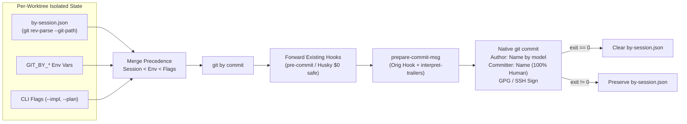

<div align="center">

# `git-by`

**Cryptographically clean, worktree-safe AI provenance for Git & multi-agent workflows.**

[](https://go.dev/)
[-3fb950?style=flat-square)](#overview)
[](#provenance-specification)
[](#overview)
[](./LICENSE)

**English** · [**简体中文**](./README.zh-CN.md)

[Overview](#overview) · [Installation](#installation) · [Quick Start](#quick-start) · [Workflows](#workflows) · [Specification](#provenance-specification) · [CLI Reference](#cli-reference)

<br />



</div>

---

## Overview

`git-by` is a zero-dependency pure-Go Git subcommand (`git by`) that records multi-agent AI contributions **before** Git computes the commit hash and cryptographic signature.

```text
$ git log -1 --format=fuller
commit 9f4c2e1a8b7d6e5f4a3b2c1d0e9f8a7b6c5d4e3f
Author:     XYZ1024 by gpt-6-astra & 1 more <xyz1024@example.com>
AuthorDate: Wed Nov 25 21:40:12 2026 +0800
Commit:     XYZ1024 <xyz1024@example.com>
CommitDate: Wed Nov 25 21:40:12 2026 +0800

    feat(auth): enforce PKCE S256 challenge verification

    Assisted-by: pi:gpt-6-astra [golangci-lint] [go-test]
    X-Agent-Orchestrator: anthropic/claude-opus-4
    X-Agent-Planner: openai/o3
    X-Agent-Implementer: openai/gpt-6-astra, anthropic/claude-sonnet-4
    X-Agent-Reviewer: google/gemini-3-pro
    X-Agent-Harness: pi@1.0.0
```

- **Signature & Identity Safe** — Passes `GIT_AUTHOR_NAME` in memory and injects trailers via `prepare-commit-msg` in a single commit pass. Never runs `post-commit --amend`, never touches `.git/config`, never invents fake `Co-authored-by` bot emails, and keeps **GPG/SSH signatures (`-S`)** and **GitHub green contribution squares** 100% intact.
- **Worktree-Isolated Multi-Agent Relay** — Tracks 5 distinct roles (`orchestrator`, `planner`, `implementer`, `reviewer`, `committer`), harness, and tools per worktree (`by-session.json`). Parallel `git worktree` agents never collide, and failed `pre-commit` hooks preserve staged provenance for retry.
- **One-Command Agent Onboarding** — `git by setup` auto-detects and configures **30 mainstream coding agents & AI IDEs** idempotently.
- **Streaming Analytics & Adaptive SVG Card** — `git by stats` analyzes Human vs. AI commits and LOC in constant memory, outputting terminal dashboards, JSON, or Light/Dark adaptive SVG cards.

<details>
<summary><strong>Why not <code>Co-authored-by</code>, <code>post-commit --amend</code>, or <code>.git/config</code> wrappers?</strong></summary>

<br />

| Dimension | `git-by` | Fake `Co-authored-by` | `post-commit --amend` | `.git/config` Mutators | Heavy Daemon / Proxy |
| :--- | :---: | :---: | :---: | :---: | :---: |
| **GPG / SSH Signatures (`-S`)** | **100% Intact** | Intact | **Broken** (rewrites SHA) | Intact | Often broken |
| **GitHub Contribution Graph** | **100% Human** | Bot account pollution | Preserved | Fragile | Proxy-dependent |
| **`git worktree` Concurrency** | **Isolated per worktree** | Manual per commit | Shared hook race | **Broken** (shared config) | Heavy sync |
| **Multi-Agent Granularity** | **5 Roles + Harness + Tools** | Single flat tag | Single flat tag | Author name only | External DB |
| **Linux Kernel `Assisted-by`** | **Native & Strict** | Violates bot policy | Partial | No trailers | Non-standard |
| **Failed `pre-commit` Retry** | **Session preserved** | Manual re-entry | Lost / double-amend | **Dirty `.git/config`** | Unpredictable |
| **Husky / Lefthook Chains** | **`$0`-safe forwarding** | Manual | `post-commit` conflict | N/A | Overrides `hooksPath` |
| **Runtime Footprint** | **1 static binary (0 deps)** | None | Shell / Node / Python | Shell scripts | Daemon + DB |

</details>

---

## Installation

Any `git-by` binary on `$PATH` is automatically discovered by Git as **`git by`**.

```bash
# Go toolchain (Recommended, Go 1.23+)
go install github.com/XYZ1024-alt/git-by/cmd/git-by@latest

# Homebrew (macOS / Linux)
brew install XYZ1024-alt/tap/git-by

# Scoop (Windows)
scoop bucket add git-by https://github.com/XYZ1024-alt/scoop-bucket
scoop install git-by

# Build from source
git clone https://github.com/XYZ1024-alt/git-by.git && cd git-by && make install
```

Prebuilt static binaries (`CGO_ENABLED=0`) for Linux, macOS, and Windows (`amd64` / `arm64`) are available on [GitHub Releases](https://github.com/XYZ1024-alt/git-by/releases).

---

## Quick Start

### 1. Auto-configure your AI coding agents (Recommended)

Run `git by setup` once after installing. On an interactive terminal, a multi-select picker opens with installed agents pre-checked (`Space` to toggle, `Enter` to install); pass `-y` in scripts/CI to configure detected agents directly without creating folders for uninstalled tools:

```text
$ git by setup
git-by setup (global)
  ↑/↓ move · Space select · a toggle all · Enter install · q/Esc cancel

  > [x] Antigravity (agy)          ~/.gemini/config/rules/git-by.md      detected
    [x] Pi Agent (pi)              ~/.pi/agent/APPEND_SYSTEM.md          detected
    [x] Claude Code (claude)       ~/.claude/rules/git-by.md             detected
    [ ] Codex (codex)              ~/.codex/AGENTS.md                    not detected
    [ ] Cursor (cursor)            ~/.cursorrules                        not detected
    ... (30 mainstream harnesses supported)
```

Once configured, your agents will automatically record roles and commit via `git by`.

### 2. Or use `git by` directly from the terminal

```bash
# Stage AI roles during development
git by set plan openai/o3 --harness claude-code@1.0.24
git by set impl anthropic/claude-sonnet-4 --tool go-test --tool golangci-lint

# Preview resolved Git Author, Committer, and Trailers
git by status

# Commit (all native git commit flags pass through: -m, -am, -S, --amend, -- <paths>)
git add .
git by commit -S -m "feat: add worktree-isolated session store"
```

---

## Workflows

### Multi-Agent Relay (`set` → `status` → `commit`)

Each worktree stores its session atomically at `$(git rev-parse --git-path by-session.json)`:

```bash
git by set orch anthropic/claude-opus-4 --harness pi@1.0.0
git by set plan openai/o3
git by set impl openai/gpt-6-astra --tool go-test
git by set impl anthropic/claude-sonnet-4 --tool golangci-lint   # appends & deduplicates
git by set rev  google/gemini-3-pro

git by status                                                    # preview before committing
git by commit -m "feat(engine): add zero-amend hook forwarding"  # clears session on exit 0
```

| Role | Aliases | Behavior |
| :--- | :--- | :--- |
| `orchestrator` | `orch` | Scalar — replaces previous value |
| `planner` | `plan` | Scalar — replaces previous value |
| `implementer` | `impl`, `code` | **List** — appends deduplicated models (comma-separated supported); `--replace` resets |
| `reviewer` | `rev` | Scalar — replaces previous value |
| `committer` | `commit` | Scalar — auto-omitted from trailers when identical to the sole `implementer` |

Use `git by clear` at any time to discard staged metadata in the current worktree.

### Stateless One-Liners, Env Vars & Amending

For single-shot commits, CI pipelines, or container sandboxes, pass flags directly or export `GIT_BY_*` variables.  
**Merge Precedence:** `by-session.json` < `GIT_BY_*` env vars < `git by commit` flags.

```bash
# Stateless one-liner
git by commit --impl anthropic/claude-sonnet-4 --plan openai/o3 --tool vitest -am "feat: PKCE verifier"

# Environment variable configuration
export GIT_BY_IMPLEMENTER="openai/gpt-6-astra,anthropic/claude-sonnet-4"
export GIT_BY_HARNESS="agy@2.0"
export GIT_BY_TOOLS="go-test,golangci-lint"
git by commit -m "refactor: extract trailer encoder"

# Amend cleanly (preserves original author, refreshes managed trailers without duplicates)
git by commit --impl anthropic/claude-sonnet-4 --amend --no-edit

# Strip AI author suffix and managed trailers from an existing commit
git by commit --clear-trailers --amend --no-edit
```

### Agent Rule Management (`setup` & `prompt`)

`git by setup` manages an idempotent `<!-- git-by:start --> ... <!-- git-by:end -->` block across global or repository rule files, tailoring `--harness <name>` per tool:

```bash
git by setup                              # Interactive global picker
git by setup --yes                        # Non-interactive auto-detect
git by setup --project                    # Repository scope (AGENTS.md, CLAUDE.md, etc.)
git by setup --agent agy,claude,cursor    # Target specific harnesses directly
git by setup --dry-run                    # Preview changes without writing to disk
git by setup --uninstall                  # Cleanly remove rules (alias: --remove)

git by prompt >> custom-agent-rules.md    # Print raw rule block to stdout (alias: init-skill)
```

<details>
<summary><strong>View all 30 supported agent harnesses & custom directory env vars</strong></summary>

<br />

- **CLI Harnesses (17):** Antigravity (`agy`), Claude Code (`claude`), OpenAI Codex (`codex`), Gemini CLI (`gemini`), OpenCode (`opencode`), Pi Agent (`pi`), Oh My Pi (`omp`), DeepSeek Harness (`dsh`), Factory Droid (`droid`), Amp (`amp`), Goose (`goose`), Crush (`crush`), Qwen Code (`qwen`), Kimi Code (`kimi`), Aider (`aider`), OpenHands (`openhands`), Hermes Agent (`hermes`)
- **AI IDEs & Editor Extensions (13):** Cursor (`cursor`), Windsurf (`windsurf`), GitHub Copilot (`copilot`), Cline (`cline`), Roo Code (`roo`), Kilo Code (`kilo`), Kiro (`kiro`), Continue (`continue`), Trae (`trae`), Augment (`augment`), CodeBuddy (`codebuddy`), JetBrains Junie (`junie`), Zed (`zed`)
- **Custom Home Overrides:** Honors `$PI_CODING_AGENT_DIR`, `$OMP_CODING_AGENT_DIR`, `$CODEX_HOME`, `$COPILOT_HOME`, `$CLINE_DIR`, `$DSH_HOME`, `$KIMI_CODE_HOME`, and `$HERMES_HOME`.

</details>

### Sense-Free Hook Mode (`hook`)

Prefer running plain `git commit` (or committing from an IDE GUI) while still injecting trailers from `by-session.json` / `GIT_BY_*` and clearing the session afterward?

```bash
git by hook install             # Current repository (compatible with core.hooksPath, Husky, Lefthook)
git by hook install --global    # Global hooks (~/.config/git/hooks)
git by hook uninstall           # Remove git-by snippet while keeping existing custom hooks intact
```

> **Note:** Hook mode injects all provenance trailers on plain `git commit` (and skips double-execution during `git by commit`). Use `git by commit` whenever you also want the dynamic `Author: <Name> by <model>` header, as Git locks `GIT_AUTHOR_NAME` before hooks run.

### Analytics & Adaptive SVG Card (`stats`)

```bash
git by stats                                       # Interactive ANSI terminal dashboard
git by stats --since "2026-01-01" --top 10         # Filter timeframe & leaderboard depth
git by stats --since "30 days ago" --json          # Structured JSON for CI / telemetry
git by stats --badge ./assets/ai-provenance.svg    # Adaptive Light/Dark SVG (--theme auto|dark|light)
```

Embed the generated card in Markdown:

```markdown

```

---

## Provenance Specification

### 1. Dynamic Author + Untouched Human Committer

- **Primary model priority:** `Implementer[0] > Planner > Orchestrator > Committer` (provider prefix before the last `/` is stripped: `openai/gpt-6-astra` → `gpt-6-astra`).
- **Single primary model:** `GIT_AUTHOR_NAME` becomes `<user.name> by <short-model-id>` (e.g., `XYZ1024 by gpt-6-astra`).
- **Multiple `Implementer` models (`M > 1`):** `GIT_AUTHOR_NAME` becomes `<user.name> by <first-short-model-id> & <M-1> more`.
- **100% Human Committer & Email:** `GIT_AUTHOR_EMAIL`, `GIT_COMMITTER_NAME`, and `GIT_COMMITTER_EMAIL` remain untouched.

### 2. Canonical Git Trailers

Compatible with Linux Kernel `coding-assistants` guidelines (`Co-authored-by` and `Signed-off-by` are **never** emitted for AI). Non-empty fields are written in strict order:

| # | Trailer Key | Format & Rules |
| :---: | :--- | :--- |
| 1 | `Assisted-by` | `<harness>:<short-model-id> [tool1] [tool2]` (strips `@version`; omits `<harness>:` or `[tool]` when unset) |
| 2 | `X-Agent-Orchestrator` | `<provider/model-id>` — top-level coordinator / router |
| 3 | `X-Agent-Planner` | `<provider/model-id>` — architecture / plan author |
| 4 | `X-Agent-Implementer` | `<provider/model-id>, ...` — comma-joined, deduplicated in order |
| 5 | `X-Agent-Reviewer` | `<provider/model-id>` — review / verification model |
| 6 | `X-Agent-Committer` | `<provider/model-id>` — auto-omitted when identical to the sole `Implementer` |
| 7 | `X-Agent-Harness` | `<name@version>` — full runtime identifier (e.g., `claude-code@1.0.24`, `pi@1.0.0`) |

<details>
<summary><strong>Architecture & Commit Lifecycle Diagram</strong></summary>

<br />



</details>

---

## CLI Reference

| Command | Summary |
| :--- | :--- |
| `git by setup [flags]` | Configure, preview, or remove provenance rules across 30 AI agents |
| `git by set <role> <model> [flags]` | Stage role, harness, and tools in the current worktree session |
| `git by status [--no-color]` | Preview merged roles, `Author`, `Committer`, and `Trailers` |
| `git by clear` | Clear staged provenance metadata for the current worktree |
| `git by commit [flags] [git-flags]` | Commit with dynamic `Author` & trailers, forwarding all `git commit` flags |
| `git by hook <install\|uninstall>` | Manage chain-safe `prepare-commit-msg` and `post-commit` hooks |
| `git by stats [flags]` | Stream-analyze Human vs. AI commits/LOC into terminal, JSON, or SVG |
| `git by prompt` (`init-skill`) | Print the managed `<!-- git-by:start -->` Markdown rule block to stdout |
| `git by version` / `git by help` | Show version or detailed per-command usage (`git by help <command>`) |

<details>
<summary><strong>Full Flag & Environment Variable Reference</strong></summary>

<br />

**`git by setup`**
- `--global` (default) / `--project` — User-level harnesses vs. repository rule files (`AGENTS.md`, `CLAUDE.md`, `GEMINI.md`, `.cursorrules`, etc.)
- `--agent <names>` — Comma-separated or repeatable harness IDs
- `-y, --yes` — Skip interactive TTY picker and configure detected targets
- `--uninstall` (alias `--remove`) — Delete standalone rule files and strip managed blocks losslessly
- `--dry-run` — Preview planned changes without disk writes
- `--no-color` — Disable ANSI color output

**`git by set <role> <model>`**
- `--harness <name>` — Record agent runtime (e.g., `pi@1.0.0`, `agy@2.0`)
- `--tool <tool>` — Record verification/external tools (repeatable or comma-separated)
- `--replace` — Replace existing implementers/tools instead of appending

**`git by commit`**
- `--orch`, `--orchestrator <model>` / `--plan`, `--planner <model>` / `--impl`, `--implementer <model>` (repeatable) / `--rev`, `--reviewer <model>` / `--committer <model>`
- `--harness <name>` / `--tool <tool>` (repeatable)
- `--clear-trailers` — Strip managed AI trailers and author attribution suffix (ideal with `--amend`)
- All native `git commit` arguments (`-m`, `-am`, `-S`, `--amend`, `--no-verify`, `-- <paths>`, etc.) are forwarded verbatim.

**`git by hook <install|uninstall>`**
- `--global` — Target global `core.hooksPath` (`~/.config/git/hooks` by default)

**`git by stats`**
- `--since <date>` — Analyze commits since date/ref
- `--top <n>` — Leaderboard depth per role (default: `5`)
- `--json` — Machine-readable JSON output
- `--badge <output.svg>` — Write standalone SVG card (`--theme auto|dark|light`, default `auto`)
- `--no-color` — Disable ANSI colors

**Environment Variables (`GIT_BY_*` & `NO_COLOR`)**
- `GIT_BY_ORCHESTRATOR`, `GIT_BY_PLANNER`, `GIT_BY_IMPLEMENTER`, `GIT_BY_REVIEWER`, `GIT_BY_COMMITTER`, `GIT_BY_HARNESS`, `GIT_BY_TOOLS`
- `NO_COLOR` — Disables ANSI colors across CLI commands when non-empty

</details>

---

## License

Released under the [MIT License](./LICENSE).
