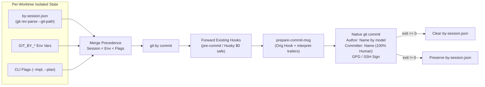

<div align="center">

# `git-by`

**Cryptographically clean, worktree-safe AI provenance for Git & multi-agent workflows.**  
*为 Git 与多智能体协作打造的零侵入、签名安全、Worktree 隔离的 AI 代码溯源工具。*

[](https://go.dev/)
[-3fb950?style=flat-square)](#why-git-by)
[](#core-design--provenance-standard)
[](#why-git-by)
[](./LICENSE)

[**English**](#english) · [**简体中文**](#简体中文)

<br />


</div>

---

<a id="english"></a>

## English

> **Jump to:** [Why `git-by`?](#why-git-by) · [Provenance Standard](#core-design--provenance-standard) · [Installation & Quick Start](#installation--quick-start) · [Agent Setup](#agent-auto-setup--prompt-rules) · [Multi-Agent Relay & One-Liners](#multi-agent-relay--stateless-workflows) · [Hook Mode](#sense-free-hook-mode) · [Analytics & SVG Badge](#provenance-analytics--svg-badge) · [CLI Reference](#cli-reference-summary) · [**简体中文文档**](#简体中文)

### Why `git-by`?

Modern software is increasingly built by **human-directed multi-agent relays**: one model orchestrates, a reasoning model plans, one or more coding models implement, and another model reviews before you commit. Yet recording AI provenance in Git today forces teams into broken trade-offs:

- **Fake `Co-authored-by` emails** (`noreply@anthropic.com`) pollute contributor graphs, invent pseudo-accounts, flatten multi-agent roles into one line, and conflict with upstream policies (such as the Linux Kernel `coding-assistants` guidelines) where bots cannot hold legal authorship or DCO `Signed-off-by` standing.
- **`post-commit` + `git commit --amend` wrappers** mutate the commit *after* Git signs it — silently **destroying GPG/SSH commit signatures** (`commit.gpgsign=true` / `-S`).
- **`.git/config` `user.name` mutators** rewrite shared repository configuration on disk — causing **race conditions across concurrent `git worktree` agents** and leaving broken identity state if a linter aborts the commit.
- **Heavy daemons & VCS proxies** add background processes, external runtime dependencies, or break Husky / Lefthook hook chains.

`git-by` solves all four cleanly in a **single static pure-Go binary with zero external dependencies**:

| Dimension | `git-by` | Fake `Co-authored-by` Emails | `post-commit --amend` Hooks | `.git/config` Mutators | Heavy Daemon / Proxy Wrappers |
| :--- | :---: | :---: | :---: | :---: | :---: |
| **GPG / SSH Commit Signatures (`-S`)** | **100% Intact** | Intact | **Broken** (rewrites signed SHA) | Intact | Often broken / requires key forwarding |
| **GitHub Green Contribution Squares** | **100% Preserved** | Pollutes graph with bot users | Preserved | Fragile if email touched | Depends on proxy |
| **`git worktree` Concurrent Agents** | **Isolated per worktree** | Manual per commit | Shared hook race risk | **Broken** (bleeds across worktrees) | Heavy state sync |
| **Multi-Agent Role Granularity** | **5 Roles + Harness + Tools** | Flat single-line tag | Flat tag | Single author string only | Proprietary DB outside Git |
| **Linux Kernel `Assisted-by` Spec** | **Native & Strict** | Violates bot-coauthor policy | Partial | No trailers | Custom non-standard headers |
| **Failed `pre-commit` Recovery** | **Session preserved** | Manual re-entry | Lost or double-amended | **Leaves dirty `.git/config`** | Unpredictable |
| **Husky / Lefthook Compatibility** | **`$0`-safe chain forwarding** | Manual | Conflicts with `post-commit` | N/A | Often overrides `core.hooksPath` |
| **Runtime Footprint** | **Single static binary (0 deps)** | None | Shell / Node / Python scripts | Shell scripts | Background daemon + DB |

---

### Core Design & Provenance Standard

`git-by` records provenance in two complementary, standard-compliant layers at commit creation time — **before** Git computes the commit tree hash and cryptographic signature:

```text
$ git log -1 --format=fuller
commit 9f4c2e1a8b7d6e5f4a3b2c1d0e9f8a7b6c5d4e3f
Author:     XYZ1024 by gpt-6-astra & 1 more <xyz1024@example.com>
AuthorDate: Wed Nov 25 21:40:12 2026 +0800
Commit:     XYZ1024 <xyz1024@example.com>
CommitDate: Wed Nov 25 21:40:12 2026 +0800

    feat(auth): enforce PKCE S256 challenge verification

    Assisted-by: pi:gpt-6-astra [golangci-lint] [go-test]
    X-Agent-Orchestrator: anthropic/claude-opus-4
    X-Agent-Planner: openai/o3
    X-Agent-Implementer: openai/gpt-6-astra, anthropic/claude-sonnet-4
    X-Agent-Reviewer: google/gemini-3-pro
    X-Agent-Harness: pi@1.0.0
```

#### 1. Dynamic Author Display + 100% Human Committer Identity

When committing via `git by commit`, `git-by` passes environment variables only to the spawned `git commit` child process (never mutating `.git/config`):

- **Single primary model (`GIT_AUTHOR_NAME="<user.name> by <short-model-id>"`)** — `git log`, GitHub PR commit lists, and `git blame` immediately show *who drove the change and with which primary model* (e.g., `XYZ1024 by gpt-6-astra`), paired with your **original `GIT_AUTHOR_EMAIL`**.
- **Multiple `Implementer` models (`GIT_AUTHOR_NAME="<user.name> by <first-short-model-id> & <M-1> more"`)** — when `M > 1` distinct coding models contribute, `Author` renders unambiguously as `XYZ1024 by gpt-6-astra & 1 more` without colliding with model version numbers.
- **`GIT_COMMITTER_NAME` & `GIT_COMMITTER_EMAIL` stay 100% untouched** as the human user — combined with your verified `GIT_AUTHOR_EMAIL`, **GitHub green contribution squares remain 100% yours**, and **GPG/SSH commit signatures (`-S` / `commit.gpgsign`) sign the final message in a single pass**.

#### 2. Primary Model Resolution Priority

When multiple agent roles participate in a commit, the `<short-model-id>` selected for `GIT_AUTHOR_NAME` and `Assisted-by` follows strict execution-impact precedence:

```text
Implementer[0]  >  Planner  >  Orchestrator  >  Committer
```

- Provider prefixes up to the last `/` are stripped for readability (`openai/gpt-6-astra` -> `gpt-6-astra`, `anthropic/claude-sonnet-4` -> `claude-sonnet-4`).
- **Single primary model**: renders as **`XYZ1024 by gpt-6-astra`**.
- **Multiple distinct `Implementer` models (`M > 1`)**: `Author` appends ` & <M-1> more` after the first implementer's short ID — e.g., `openai/gpt-6-astra` + `anthropic/claude-sonnet-4` renders as **`XYZ1024 by gpt-6-astra & 1 more`**, while `Assisted-by: pi:gpt-6-astra [golangci-lint] [go-test]` uses the clean primary short model ID and `X-Agent-Implementer` lists all models in full.

#### 3. Ordered Git Trailers (Linux Kernel `coding-assistants` Compatible)

`git-by` injects trailers via `git interpret-trailers` inside an ephemeral `prepare-commit-msg` pipeline. It **never** emits `Co-authored-by` or `Signed-off-by` for AI models. Non-empty fields are emitted in strict canonical order:

| Order | Trailer Key | Format & Rules |
| :---: | :--- | :--- |
| `1` | `Assisted-by` | `<harness>:<short-model-id> [tool1] [tool2]` (strips `@version` from harness; omits `<harness>:` if unset; omits `[tool]` if none) |
| `2` | `X-Agent-Orchestrator` | `<provider/model-id>` — top-level swarm coordinator / task router |
| `3` | `X-Agent-Planner` | `<provider/model-id>` — architectural / implementation plan author |
| `4` | `X-Agent-Implementer` | `<provider/model-id>, <provider/model-id>` — comma-joined, deduplicated in order |
| `5` | `X-Agent-Reviewer` | `<provider/model-id>` — code review / verification model |
| `6` | `X-Agent-Committer` | `<provider/model-id>` — **Smart Denoising**: auto-omitted when identical to the sole `Implementer` |
| `7` | `X-Agent-Harness` | `<name@version>` — full agent runtime identifier (e.g., `claude-code@1.0.24`, `pi@1.0.0`, `agy@2.0`) |

---

### Architecture & Commit Lifecycle



---

### Installation & Quick Start

Any executable named `git-by` on your `$PATH` is automatically discovered by Git as the **`git by`** subcommand.

#### Install via `go install` (Recommended)

```bash
go install github.com/XYZ1024-alt/git-by/cmd/git-by@latest
```

#### Package Managers & Prebuilt Releases

```bash
# Homebrew (macOS / Linux)
brew install XYZ1024-alt/tap/git-by

# Scoop (Windows)
scoop bucket add git-by https://github.com/XYZ1024-alt/scoop-bucket
scoop install git-by

# Build & install from source
git clone https://github.com/XYZ1024-alt/git-by.git
cd git-by
make install
```

Static `CGO_ENABLED=0` binaries for **Linux**, **macOS**, and **Windows** (`amd64` & `arm64`) are available on the [GitHub Releases](https://github.com/XYZ1024-alt/git-by/releases) page.

#### Quick Start

**Step 1 — Auto-configure your installed coding agents (`git by setup`)**

Run `git by setup` (defaults to `--global`) once right after installing. It auto-detects installed coding agents (**Antigravity**, **Pi**, **Claude Code**, **Codex**, **OpenCode**, plus existing **Cursor** / **Windsurf** rules) and surgically injects idempotent provenance rules — **never** creating directories for uninstalled tools:

```text
$ git by setup
git-by setup (global)

  ✔ Antigravity   installed   ~/.gemini/config/rules/git-by.md
  ✔ Pi Agent      updated     ~/.pi/agent/APPEND_SYSTEM.md
  ✔ Claude Code   installed   ~/.claude/rules/git-by.md
  - Codex         skipped     (~/.codex not found)
  - OpenCode      skipped     (~/.config/opencode not found)

Configured 3 agent(s). Your AI commits will now carry provenance automatically.
```

**Step 2 — Or drive `git by` directly from your terminal**

```bash
# 1. Stage AI participation during your workflow
git by set plan openai/o3 --harness claude-code@1.0.24
git by set impl anthropic/claude-sonnet-4 --tool go-test --tool golangci-lint

# 2. Preview Author, Committer, and Git Trailers before committing
git by status

# 3. Commit with any native git commit flags (-m, -am, -S, --amend, -- <paths>)
git add .
git by commit -S -m "feat: add worktree-isolated session store"
```

---

### Agent Auto-Setup & Prompt Rules

`git by setup` manages a bounded, idempotent `<!-- git-by:start --> ... <!-- git-by:end -->` rule block across global agent configurations or per-repository instruction files, automatically tailoring `--harness <name>` for each agent:

```bash
# Global auto-detection (default): configures only installed coding agents in $HOME
git by setup
git by setup --global

# Repository scope: injects managed block into repo AGENTS.md, plus existing
# CLAUDE.md / .cursorrules / .windsurfrules without creating clutter files
git by setup --project

# Target specific agents (comma-separated or repeatable):
# agy, pi, claude, codex, opencode, cursor, windsurf
git by setup --agent agy,claude,cursor

# Preview planned actions with zero disk writes
git by setup --dry-run

# Uninstall (alias: --remove): cleanly deletes standalone rule files and losslessly
# strips <!-- git-by:start --> ... <!-- git-by:end --> from shared files
git by setup --uninstall
git by setup --project --remove
```

| Flag | Behavior |
| :--- | :--- |
| *(default)* / `--global` | Auto-detects installed global agents (`~/.gemini`, `~/.pi`, `~/.claude`, `~/.codex`, `~/.config/opencode`, plus existing `~/.cursorrules` / `~/.windsurfrules`) without creating directories for uninstalled tools |
| `--project` | Injects managed block into repo `AGENTS.md`, and updates any existing `CLAUDE.md`, `.cursorrules`, or `.windsurfrules` without creating clutter |
| `--agent <names>` | Filter target agents (`agy`, `pi`, `claude`, `codex`, `opencode`, `cursor`, `windsurf`) |
| `--dry-run` | Preview `installed` / `updated` / `removed` / `skipped` targets with zero filesystem changes |
| `--uninstall`, `--remove` | Delete standalone `git-by.md` rule files and losslessly restore shared files byte-for-byte |
| `--no-color` | Disable ANSI color output |

#### Manual Inspection & Piping (`git by prompt` / `git by init-skill`)

Need to inspect the raw unified rule block or pipe it into a custom agent harness? `git by prompt` (alias `git by init-skill`) prints the exact `<!-- git-by:start --> ... <!-- git-by:end -->` Markdown block to stdout:

```bash
# Inspect the unified provenance prompt block
git by prompt

# Or append manually to custom instruction files
git by init-skill >> custom-agent-rules.md
```

---

### Multi-Agent Relay & Stateless Workflows

#### 1. Stateful Multi-Agent Relay (`git by set` -> `status` -> `commit`)

Each `git worktree` stores its own session atomically at `$(git rev-parse --git-path by-session.json)` — two agents working in parallel worktrees never overwrite or leak metadata into each other.

```bash
# Stage 1: Orchestrator dispatches task
git by set orch anthropic/claude-opus-4 --harness pi@1.0.0

# Stage 2: Planner designs architecture
git by set plan openai/o3

# Stage 3: Multiple Implementers write & refine code (appends & deduplicates in order)
git by set impl openai/gpt-6-astra --tool go-test
git by set impl anthropic/claude-sonnet-4 --tool golangci-lint

# (Optional) Replace implementer list instead of appending:
# git by set impl anthropic/claude-sonnet-4 --replace

# Stage 4: Reviewer audits diff
git by set rev google/gemini-3-pro

# Stage 5: Inspect staged provenance panel (respects NO_COLOR)
git by status

# Stage 6: Commit! If pre-commit fails, by-session.json is safely preserved for retry.
git by commit -m "feat(engine): add zero-amend hook forwarding"

# Or discard staged session metadata at any time:
git by clear
```

**Supported Role Names & Short Aliases:**

| Canonical Role | Aliases | Multi-Value Behavior |
| :--- | :--- | :--- |
| `orchestrator` | `orch` | Scalar (replaces previous value) |
| `planner` | `plan` | Scalar (replaces previous value) |
| `implementer` | `impl`, `code` | **List** — appends deduplicated models (comma-separated supported); `--replace` resets |
| `reviewer` | `rev` | Scalar (replaces previous value) |
| `committer` | `commit` | Scalar (auto-omitted from trailers if identical to sole `implementer`) |

#### 2. Stateless One-Liner Flags & `GIT_BY_*` Environment Variables

Prefer zero session files in CI pipelines or single-shot scripts? Pass roles directly on `git by commit` or export `GIT_BY_*` environment variables.

**Merge Precedence:** `by-session.json` < `GIT_BY_*` Env Vars < `git by commit` CLI Flags.

```bash
# Stateless one-liner commit (all native git commit flags pass through verbatim)
git by commit \
  --impl anthropic/claude-sonnet-4 \
  --plan openai/o3 \
  --rev google/gemini-3-pro \
  --harness cursor@0.49 \
  --tool eslint --tool vitest \
  -am "feat: stateless OAuth PKCE verifier"

# Environment variable configuration (ideal for agent sandboxes & CI runners)
export GIT_BY_ORCHESTRATOR="anthropic/claude-opus-4"
export GIT_BY_PLANNER="openai/o3"
export GIT_BY_IMPLEMENTER="openai/gpt-6-astra,anthropic/claude-sonnet-4"
export GIT_BY_REVIEWER="google/gemini-3-pro"
export GIT_BY_COMMITTER="anthropic/claude-haiku-4"
export GIT_BY_HARNESS="agy@2.0"
export GIT_BY_TOOLS="go-test,golangci-lint"

git by commit -m "refactor: extract trailer encoder"
```

---

### Sense-Free Hook Mode

Want agents or IDE Git clients to run plain `git commit` while still injecting `Assisted-by` and `X-Agent-*` trailers from `by-session.json` / `GIT_BY_*` and clearing the session afterward?

```bash
# Install into current repository (respects local core.hooksPath, Husky, and Lefthook)
git by hook install

# Or install globally (~/.config/git/hooks or existing global core.hooksPath)
git by hook install --global

# Cleanly remove git-by hook snippets while keeping your existing custom hooks intact
git by hook uninstall
git by hook uninstall --global
```

- **Chain-Safe & Idempotent**: Wraps existing `prepare-commit-msg` and `post-commit` hooks cleanly instead of overwriting them, and sets `GIT_BY_ACTIVE=1` during `git by commit` so hooks never double-execute.
- **Tip**: Native `git commit` with Hook Mode automatically injects all provenance trailers and clears `by-session.json`; use `git by commit` whenever you also want dynamic `Author: <Name> by <model>` header attribution (since Git locks `GIT_AUTHOR_NAME` before invoking hooks).

---

### Provenance Analytics & SVG Badge

Turn your repository's Git trailer history (including Linux Kernel-style `Assisted-by` commits!) into actionable engineering insights or a live README card:

```bash
# Render interactive ANSI terminal dashboard
git by stats

# Filter by timeframe & control leaderboard depth
git by stats --since "2026-01-01" --top 10

# Export structured JSON for CI pipelines & engineering telemetry
git by stats --since "30 days ago" --json

# Generate standalone GitHub-Dark SVG provenance card (zero external fonts/assets)
git by stats --badge ./assets/ai-provenance.svg
```

Embed the generated SVG anywhere in your `README.md`:

```markdown

```

---

### CLI Reference Summary

| Command | Description |
| :--- | :--- |
| `git by setup [--global \| --project] [--agent <names>] [--uninstall \| --remove] [--dry-run] [--no-color]` | Auto-detect coding agents and idempotently install, update, preview, or remove provenance rules |
| `git by set <role> <model> [--harness <h>] [--tool <t>...] [--replace]` | Record agent participation in the current worktree's `by-session.json` |
| `git by status` | Preview merged roles, `Git Author`, `Git Committer`, and `Git Trailers` |
| `git by clear` | Clear staged provenance metadata for the current worktree |
| `git by commit [git-by flags] [git commit flags...]` | Commit with dynamic `Author`, ordered trailers, `$0`-safe hooks, and session cleanup |
| `git by hook install [--global]` | Install chain-safe `prepare-commit-msg` & `post-commit` hooks |
| `git by hook uninstall [--global]` | Remove `git-by` hooks while preserving pre-existing user hooks |
| `git by stats [--since <date>] [--json] [--badge <path>] [--top <n>]` | Analyze Human vs AI commits/LOC and render terminal/JSON/SVG reports |
| `git by prompt` / `git by init-skill` | Print the unified `<!-- git-by:start --> ... <!-- git-by:end -->` agent rule block to stdout |
| `git by version` / `git by help` | Display binary version or command usage |

---
---

<a id="简体中文"></a>

## 简体中文

> **快速导航：** [为什么选择 `git-by`？](#为什么选择-git-by) · [核心设计与溯源规范](#核心设计与溯源规范) · [安装与快速上手](#安装与快速上手) · [Agent 自动配置](#agent-自动配置与提示词生成) · [多智能体接力与单行模式](#多智能体接力与无状态单行模式) · [无感 Hook 模式](#无感-hook-模式) · [统计面板与 SVG 徽章](#代码溯源统计与-svg-卡片) · [CLI 命令速查](#cli-命令速查表) · [**English Docs**](#english)

### 为什么选择 `git-by`？

在多智能体（Multi-Agent）研发工作流中，一次提交往往由**编排模型（Orchestrator）调度、推理模型（Planner）规划、一个或多个编码模型（Implementer）实现、审查模型（Reviewer）把关**，最后由人类开发者确认提交。然而现有的 Git AI 标记方案普遍存在严重工程缺陷：

- **伪造 `Co-authored-by` 机器人邮箱**（如 `noreply@anthropic.com`）：污染 GitHub Contributors 贡献者列表、丢失多角色分工细节，且违背 Linux Kernel `coding-assistants` 等主流开源社区规范（AI 不具备法律主体资格，不应使用 `Co-authored-by` 或 DCO `Signed-off-by`）。
- **`post-commit` + `git commit --amend` 事后篡改方案**：在 Git 完成提交签名**之后**重写 Commit SHA，直接导致 **GPG / SSH 提交签名（`-S` / `commit.gpgsign=true`）彻底失效**！
- **直接修改 `.git/config` `user.name` 的工具**：污染仓库共享配置文件，在多智能体并行使用 **`git worktree` 时引发严重的并发串台与竞态覆盖**；一旦 `pre-commit` 检查失败退出，还会留下脏配置。
- **重型守护进程 / Git 代理包装器**：引入后台常驻进程或外部依赖，极易破坏现有的 Husky / Lefthook 钩子链。

`git-by` 以**纯 Go 标准库编写的单文件静态二进制（零外部依赖）**，一次性彻底解决上述痛点：

| 对比维度 | `git-by` | 伪造 `Co-authored-by` 邮箱 | `post-commit --amend` 钩子 | 修改 `.git/config` 方案 | 重型 Daemon / 代理包装器 |
| :--- | :---: | :---: | :---: | :---: | :---: |
| **GPG / SSH 签名完整性 (`-S`)** | **100% 完好有效** | 有效 | **签名损坏**（篡改已签名 SHA） | 有效 | 常需额外代理转发或易失效 |
| **GitHub 绿格子（贡献统计）** | **100% 归属人类开发者** | 混入虚假机器人账号 | 保留 | 若触碰邮箱即丢失绿格子 | 取决于代理实现 |
| **`git worktree` 多智能体并发** | **按 Worktree 物理隔离** | 需每次手动拼写 | 钩子共享状态易冲突 | **严重串台**（共享 `.git/config`） | 状态同步笨重 |
| **多智能体分工粒度** | **5 大角色 + Harness + 工具链** | 单行扁平标签 | 单行扁平标签 | 仅能改作者名 | 存储在 Git 之外的私有库 |
| **Linux Kernel `Assisted-by` 兼容** | **原生严格遵循** | 违反禁止 AI Co-author 规范 | 部分兼容 | 无规范 Trailer | 私有非标字段 |
| **`pre-commit` 失败重试保护** | **自动保留会话不丢失** | 需重新手动输入 | 丢失或重复 amend | **残留脏 `.git/config`** | 不可预期 |
| **Husky / Lefthook 钩子兼容** | **保留 `$0` 安全链式转发** | 手动 | 与现有 `post-commit` 冲突 | 无 | 常覆盖 `core.hooksPath` |
| **运行时体积与依赖** | **单一静态二进制（0 依赖）** | 无 | 依赖 Shell / Node / Python | Shell 脚本 | 后台常驻进程 + 数据库 |

---

### 核心设计与溯源规范

`git-by` 在调用原生 `git commit` 生成哈希与加密签名**之前**，通过内存态环境变量与临时钩子管道一次性完成双层溯源注入：

```text
$ git log -1 --format=fuller
commit 9f4c2e1a8b7d6e5f4a3b2c1d0e9f8a7b6c5d4e3f
Author:     XYZ1024 by gpt-6-astra & 1 more <xyz1024@example.com>
AuthorDate: Wed Nov 25 21:40:12 2026 +0800
Commit:     XYZ1024 <xyz1024@example.com>
CommitDate: Wed Nov 25 21:40:12 2026 +0800

    feat(auth): enforce PKCE S256 challenge verification

    Assisted-by: pi:gpt-6-astra [golangci-lint] [go-test]
    X-Agent-Orchestrator: anthropic/claude-opus-4
    X-Agent-Planner: openai/o3
    X-Agent-Implementer: openai/gpt-6-astra, anthropic/claude-sonnet-4
    X-Agent-Reviewer: google/gemini-3-pro
    X-Agent-Harness: pi@1.0.0
```

#### 1. 动态 Git Author 展示 + 100% 纯人类 Committer 身份

执行 `git by commit` 时，`git-by` 仅向子进程注入环境变量，绝不触碰 `.git/config`：

- **单主模型展示（`GIT_AUTHOR_NAME="<user.name> by <short-model-id>"` + 原始 `GIT_AUTHOR_EMAIL`）**：在 `git log`、GitHub Commit 列表与 `git blame` 中一眼可见主笔模型（如 `XYZ1024 by gpt-6-astra`）。
- **多实现模型协作展示（`GIT_AUTHOR_NAME="<user.name> by <first-short-model-id> & <M-1> more"`）**：当存在 `M > 1` 个不同 `Implementer` 模型参与时，清晰显示为 `XYZ1024 by gpt-6-astra & 1 more`，彻底避免与模型版本号产生歧义。
- **`GIT_COMMITTER_NAME` 与 `GIT_COMMITTER_EMAIL` 100% 保持人类开发者原样**：配合未改动的个人验证邮箱，**GitHub 贡献绿格子 100% 正常点亮**，且 **GPG / SSH 硬件密钥签名一次性原生通过**，无需任何 `--amend`！

#### 2. 主展示模型优先级规则

当一次提交存在多个角色参与时，用于 `GIT_AUTHOR_NAME` 与 `Assisted-by` 的 `<short-model-id>` 按实际代码产出权重自动选举：

```text
Implementer[0]（主实现者） > Planner（规划者） > Orchestrator（编排者） > Committer（提交者）
```

- 自动剥离最后一个 `/` 前的厂商前缀（例如 `openai/gpt-6-astra` -> `gpt-6-astra`、`anthropic/claude-sonnet-4` -> `claude-sonnet-4`）。
- **单一主模型**：`Author` 显示为 **`XYZ1024 by gpt-6-astra`**。
- **多个不同 `Implementer` 模型协作（`M > 1`）**：`Author` 在首个实现模型短 ID 后追加 ` & <M-1> more`（例如 `openai/gpt-6-astra` 与 `anthropic/claude-sonnet-4` 联合实现时显示为 **`XYZ1024 by gpt-6-astra & 1 more`**）；同时 `Assisted-by: pi:gpt-6-astra [golangci-lint] [go-test]` 保持整洁的主模型短 ID，完整实现模型列表记录在 `X-Agent-Implementer` 中。

#### 3. 严格有序的 Git Trailers（兼容 Linux Kernel `coding-assistants` 规范）

`git-by` 绝不注入 `Co-authored-by` 或 `Signed-off-by`，仅按以下固定顺序输出非空的标准化 Git Trailers：

```text
Assisted-by: <harness>:<short-model-id> [tool1] [tool2]
X-Agent-Orchestrator: <provider/model-id>
X-Agent-Planner: <provider/model-id>
X-Agent-Implementer: <provider/model-id>, <provider/model-id>
X-Agent-Reviewer: <provider/model-id>
X-Agent-Committer: <provider/model-id>
X-Agent-Harness: <name@version>
```

- **`Assisted-by`**：设置 Harness 时自动剥离 `@version` 版本号并使用主模型短 ID（如 `pi@1.0.0` -> `Assisted-by: pi:gpt-6-astra [golangci-lint] [go-test]`），按序附带 `[tool1] [tool2]` 验证工具标记；未设置 Harness 时直接输出 `<short-model-id>`。
- **`X-Agent-Committer` 智能降噪**：当 `Committer` 与**唯一的 `Implementer`** 完全相同时自动省略该行，避免单智能体场景下的冗余噪音；仅在独立提交代理或纯提交场景下显式记录。
- **`X-Agent-Harness`**：完整保留 `<name@version>` 运行时宿主标识（如 `claude-code@1.0.24`、`pi@1.0.0`、`agy@2.0`）。

---

### 安装与快速上手

Git 会自动将 `$PATH` 中的 `git-by` 可执行文件识别为原生子命令 **`git by`**。

```bash
# 方式一：通过 Go 工具链安装（推荐，Go 1.23+）
go install github.com/XYZ1024-alt/git-by/cmd/git-by@latest

# 方式二：Homebrew (macOS / Linux)
brew install XYZ1024-alt/tap/git-by

# 方式三：Scoop (Windows)
scoop bucket add git-by https://github.com/XYZ1024-alt/scoop-bucket
scoop install git-by

# 方式四：源码编译安装
git clone https://github.com/XYZ1024-alt/git-by.git
cd git-by && make install
```

也可直接前往 [GitHub Releases](https://github.com/XYZ1024-alt/git-by/releases) 下载适用于 `linux`、`darwin`、`windows`（`amd64` / `arm64`）的预编译无依赖静态二进制包。

#### 30 秒快速上手

**第一步：一键全局接入已安装的编程 Agent（`git by setup`）**

安装完成后只需运行一次 `git by setup`（默认 `--global`），即可自动扫描本机已安装的编程 Agent（**Antigravity**、**Pi**、**Claude Code**、**Codex**、**OpenCode**，以及已存在的 **Cursor** / **Windsurf** 全局规则），无损、幂等地注入溯源规则——**绝不会为未安装的工具创建多余配置目录**：

```text
$ git by setup
git-by setup (global)

  ✔ Antigravity   installed   ~/.gemini/config/rules/git-by.md
  ✔ Pi Agent      updated     ~/.pi/agent/APPEND_SYSTEM.md
  ✔ Claude Code   installed   ~/.claude/rules/git-by.md
  - Codex         skipped     (~/.codex not found)
  - OpenCode      skipped     (~/.config/opencode not found)

Configured 3 agent(s). Your AI commits will now carry provenance automatically.
```

**第二步：或在终端手动体验溯源提交流程**

```bash
# 1. 记录工作流中的模型分工
git by set plan openai/o3 --harness claude-code@1.0.24
git by set impl anthropic/claude-sonnet-4 --tool go-test --tool golangci-lint

# 2. 提交前预览即将生成的 Author、Committer 与 Git Trailers
git by status

# 3. 执行提交（完整透传 -m、-am、-S、--amend、-- <paths> 等原生 git commit 参数）
git add .
git by commit -S -m "feat: add worktree-isolated session store"
```

---

### Agent 自动配置与提示词生成

`git by setup` 通过受控的 `<!-- git-by:start --> ... <!-- git-by:end -->` 标记块管理全局或仓库级 Agent 规则文件，并为每个 Agent 自动匹配对应的 `--harness <name>`：

```bash
# 默认全局自动检测：仅配置 $HOME 下已安装的编程 Agent，绝不创建幽灵目录
git by setup
git by setup --global

# 仓库级接入：写入当前仓库 AGENTS.md，并自动更新已存在的 CLAUDE.md / .cursorrules / .windsurfrules（不制造多余空文件）
git by setup --project

# 指定目标 Agent（支持逗号分隔或重复传参）：
# agy, pi, claude, codex, opencode, cursor, windsurf
git by setup --agent agy,claude,cursor

# 预览即将执行的变更（零磁盘写入）
git by setup --dry-run

# 干净卸载（别名 --remove）：删除独立规则文件，并从共享文件中无损剥离 <!-- git-by:start --> ... <!-- git-by:end --> 区块
git by setup --uninstall
git by setup --project --remove
```

| 参数 | 行为说明 |
| :--- | :--- |
| *(默认)* / `--global` | 全局自动检测已安装的 Agent（`~/.gemini`、`~/.pi`、`~/.claude`、`~/.codex`、`~/.config/opencode` 及已存在的 `~/.cursorrules` / `~/.windsurfrules`），未安装工具自动跳过且不创建目录 |
| `--project` | 将受管规则块注入仓库根目录 `AGENTS.md`，并同步更新仓库内**已存在**的 `CLAUDE.md`、`.cursorrules`、`.windsurfrules`（不会新建多余文件） |
| `--agent <names>` | 精确指定目标 Agent（支持 `agy`、`pi`、`claude`、`codex`、`opencode`、`cursor`、`windsurf`） |
| `--dry-run` | 仅预览 `installed` / `updated` / `removed` / `skipped` 计划，零磁盘写入 |
| `--uninstall`, `--remove` | 删除独立的 `git-by.md` 规则文件，并从共享配置文件中按字节无损剥离 `git-by` 规则块 |
| `--no-color` | 禁用终端 ANSI 颜色输出 |

#### 手动查看与管道重定向（`git by prompt` / `git by init-skill`）

如需直接查看统一的 `<!-- git-by:start --> ... <!-- git-by:end -->` 提示词模板，或手动重定向到自定义 Agent 配置文件，可使用 `git by prompt`（同义别名 `git by init-skill`）：

```bash
# 直接在终端输出标准受管规则块
git by prompt

# 或手动追加至自定义规则文件
git by init-skill >> custom-agent-rules.md
```

---

### 多智能体接力与无状态单行模式

#### 1. 多智能体分步接力工作流（天然支持 `git worktree` 并发隔离）

`git by set` 通过 `git rev-parse --git-path by-session.json` 定位会话文件并使用原子替换写入——不同 `git worktree` 各自拥有独立的会话状态，多 Agent 并行开发互不干扰。

```bash
# 1. 编排与规划阶段记录模型信息
git by set orch anthropic/claude-opus-4 --harness pi@1.0.0
git by set plan openai/o3

# 2. 实现阶段（多次执行 impl 默认按序去重追加；加 --replace 可覆盖重置）
git by set impl openai/gpt-6-astra --tool go-test
git by set impl anthropic/claude-sonnet-4 --tool golangci-lint

# 3. 审查阶段
git by set rev google/gemini-3-pro

# 4. 提交前预览即将生成的 Git Author、Committer 与 Trailers（支持 NO_COLOR）
git by status

# 5. 执行提交（完整透传 -m、-am、-S、--amend、-- <paths> 等所有原生 git commit 参数）
# 若 pre-commit 钩子报错退出，by-session.json 会原样保留，修复后直接重跑即可！
git by commit -m "feat: implement multi-agent provenance pipeline"

# 如需手动清空当前 worktree 的暂存会话：
git by clear
```

**角色名称与简写别名对照：**
- `orchestrator`（简写 `orch`）
- `planner`（简写 `plan`）
- `implementer`（简写 `impl`、`code`）—— 支持多次追加或逗号分隔多模型（`m1,m2`）
- `reviewer`（简写 `rev`）
- `committer`（简写 `commit`）

#### 2. 无状态单行参数与 `GIT_BY_*` 环境变量

在单次提交、脚本自动化或 CI 环境中，无需预先 `git by set`，可直接使用命令行参数或环境变量。  
**合并优先级：** `by-session.json` < `GIT_BY_*` 环境变量 < `git by commit` 命令行参数。

```bash
# 单行无状态提交示例
git by commit --impl anthropic/claude-sonnet-4 --plan openai/o3 -am "feat: auth"

# 环境变量注入示例（适合 Agent 容器沙箱全局配置）
export GIT_BY_ORCHESTRATOR="anthropic/claude-opus-4"
export GIT_BY_PLANNER="openai/o3"
export GIT_BY_IMPLEMENTER="anthropic/claude-sonnet-4"
export GIT_BY_REVIEWER="google/gemini-3-pro"
export GIT_BY_COMMITTER="anthropic/claude-haiku-4"
export GIT_BY_HARNESS="claude-code@1.0.24"
export GIT_BY_TOOLS="golangci-lint,go-test"

git by commit -S -m "fix: handle empty repository stats"
```

---

### 无感 Hook 模式

如果你希望在 IDE 图形界面或习惯直接运行原生 `git commit` 时，也能自动将 `by-session.json` / `GIT_BY_*` 中的元数据注入为 Git Trailers 并在提交成功后自动清理会话：

```bash
# 为当前仓库安装钩子（自动兼容 core.hooksPath、Husky 与 Lefthook）
git by hook install

# 或安装为全局 Git 钩子（默认配置至 ~/.config/git/hooks）
git by hook install --global

# 安全卸载（完整保留你原有的自定义钩子逻辑）
git by hook uninstall [--global]
```

> **说明**：无感 Hook 模式在运行原生 `git commit` 时会自动注入全部规范 Trailers 并在 `post-commit` 清理会话（通过 `GIT_BY_ACTIVE=1` 防止与 `git by commit` 重复触发）；若同时需要动态生成 `Author: <Name> by <model>` 作者头，请使用 `git by commit`。

---

### 代码溯源统计与 SVG 卡片

`git by stats` 单趟解析仓库提交历史与 `--numstat` 代码行变更（同时兼容统计纯 Linux Kernel `Assisted-by` 风格的历史提交），支持终端可视化看板、JSON 导出与独立暗色风 SVG 统计卡片生成：

```bash
# 终端看板：展示人类 vs AI 提交占比、代码增删行数占比及 Implementer / Planner 模型排行榜
git by stats

# 按时间范围过滤并指定排行榜条数
git by stats --since "2026-01-01" --top 5

# 导出结构化 JSON 供工程效能平台消费
git by stats --since "2026-01-01" --json

# 生成零外部依赖的 GitHub Dark 风格 SVG 卡片（可直接嵌入 README.md）
git by stats --badge ./ai-provenance.svg
```

---

### CLI 命令速查表

| 命令 | 说明 |
| :--- | :--- |
| `git by setup [--global \| --project] [--agent <names>] [--uninstall \| --remove] [--dry-run] [--no-color]` | 自动检测已安装的编程 Agent，幂等安装、更新、预览或无损移除溯源规则 |
| `git by set <role> <model> [--harness <h>] [--tool <t>...] [--replace]` | 在当前 Worktree 的 `by-session.json` 中记录模型角色参与信息 |
| `git by status` | 预览合并后的多智能体分工、`Git Author`、`Git Committer` 与 `Git Trailers` |
| `git by clear` | 清空当前 Worktree 暂存的会话溯源元数据 |
| `git by commit [git-by 参数] [git commit 参数...]` | 注入动态 `Author`、有序 Trailers、`$0` 安全钩子转发并完成提交与会话清理 |
| `git by hook install [--global]` | 安装链式安全的 `prepare-commit-msg` 与 `post-commit` 钩子 |
| `git by hook uninstall [--global]` | 安全移除 `git-by` 钩子片段并保留原有自定义钩子 |
| `git by stats [--since <date>] [--json] [--badge <path>] [--top <n>]` | 统计人类 vs AI 提交与代码行数占比，输出终端看板、JSON 或 SVG 卡片 |
| `git by prompt` / `git by init-skill` | 向标准输出打印统一的 `<!-- git-by:start --> ... <!-- git-by:end -->` 规则块 |
| `git by version` / `git by help` | 查看版本号或命令帮助信息 |

---

## License

Released under the [MIT License](./LICENSE).
