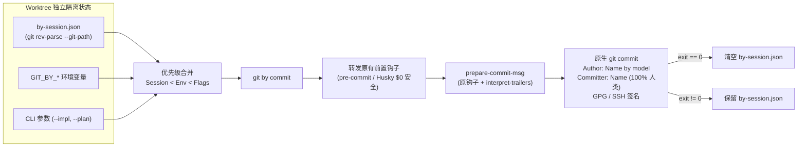

<div align="center">

# `git-by`

**为 Git 与多智能体协作打造的零侵入、签名安全、Worktree 隔离的 AI 代码溯源工具。**

[](https://go.dev/)
[-3fb950?style=flat-square)](#项目概览)
[](#溯源规范与架构)
[](#项目概览)
[](./LICENSE)

[**English**](./README.md) · **简体中文**

[项目概览](#项目概览) · [安装](#安装) · [快速上手](#快速上手) · [核心用法](#核心用法) · [溯源规范](#溯源规范与架构) · [CLI 速查](#cli-速查)

<br />



</div>

---

## 项目概览

`git-by` 是一个纯 Go 标准库编写、零外部依赖的 Git 原生子命令（`git by`），在 Git 计算 Commit 哈希与加密签名**之前**一次性完成多智能体代码溯源注入。

```text
$ git log -1 --format=fuller
commit 9f4c2e1a8b7d6e5f4a3b2c1d0e9f8a7b6c5d4e3f
Author:     XYZ1024 by gpt-6-astra & 1 more <xyz1024@example.com>
AuthorDate: Wed Nov 25 21:40:12 2026 +0800
Commit:     XYZ1024 <xyz1024@example.com>
CommitDate: Wed Nov 25 21:40:12 2026 +0800

    feat(auth): enforce PKCE S256 challenge verification

    Assisted-by: pi:gpt-6-astra [golangci-lint] [go-test]
    X-Agent-Orchestrator: anthropic/claude-opus-5.5
    X-Agent-Planner: openai/gpt-6.2-astra
    X-Agent-Implementer: openai/gpt-6-astra, anthropic/claude-sonnet-5.5
    X-Agent-Reviewer: google/gemini-4-carbon
    X-Agent-Harness: pi@1.0.0
```

- **签名与身份 100% 安全** — 仅通过子进程内存态环境变量与 `prepare-commit-msg` 管道单趟注入：绝不事后 `post-commit --amend`、绝不污染 `.git/config`、绝不伪造机器人 `Co-authored-by` 邮箱，确保 **GPG / SSH 签名（`-S`）完好有效**且 **GitHub 贡献绿格子 100% 归属开发者本人**。
- **Worktree 物理隔离的多智能体接力** — 按 Worktree 独立记录 5 大角色（`orchestrator`、`planner`、`implementer`、`reviewer`、`committer`）、宿主 Harness 与验证工具（`by-session.json`）；多 Agent 并行互不串台，`pre-commit` 检查失败时自动保留会话以便重试。
- **一键接入主流编程 Agent** — `git by setup` 自动检测并幂等配置 **30 款主流 CLI 智能体与 AI IDE**。
- **流式统计看板与自适应 SVG 卡片** — `git by stats` 以恒定内存单趟扫描仓库提交与代码行数占比，支持终端看板、JSON 导出及深浅色自适应 SVG 徽章卡片。

<details>
<summary><strong>为什么不用 <code>Co-authored-by</code>、<code>post-commit --amend</code> 或修改 <code>.git/config</code>？</strong></summary>

<br />

| 对比维度 | `git-by` | 伪造 `Co-authored-by` | `post-commit --amend` | 修改 `.git/config` | 重型 Daemon / 代理 |
| :--- | :---: | :---: | :---: | :---: | :---: |
| **GPG / SSH 签名 (`-S`)** | **100% 完好有效** | 有效 | **签名损坏**（重写 SHA） | 有效 | 易失效 / 需代理密钥 |
| **GitHub 绿格子统计** | **100% 归属人类** | 混入虚假机器人账号 | 保留 | 改邮箱即丢失 | 取决于代理实现 |
| **`git worktree` 并发** | **按 Worktree 隔离** | 每次手动拼写 | 共享钩子竞态 | **严重串台**（共享配置） | 状态同步笨重 |
| **多智能体分工粒度** | **5 角色 + Harness + 工具** | 单行扁平标签 | 单行扁平标签 | 仅能改作者名 | 外部私有数据库 |
| **Linux Kernel `Assisted-by`** | **原生严格遵循** | 违反禁 AI Co-author | 部分兼容 | 无规范 Trailer | 私有非标字段 |
| **`pre-commit` 失败重试** | **自动保留会话** | 需手动重输 | 丢失或重复 amend | **残留脏 `.git/config`** | 不可预期 |
| **Husky / Lefthook 兼容** | **`$0` 安全链式转发** | 手动 | `post-commit` 冲突 | 无 | 常覆盖 `hooksPath` |
| **运行时体积与依赖** | **单文件静态二进制（0 依赖）** | 无 | Shell / Node / Python | Shell 脚本 | 后台常驻进程 + DB |

</details>

---

## 安装

Git 会自动将 `$PATH` 中的 `git-by` 可执行文件识别为原生子命令 **`git by`**。

```bash
# Go 工具链安装（推荐，Go 1.23+）
go install github.com/XYZ1024-alt/git-by/cmd/git-by@latest

# Homebrew (macOS / Linux)
brew install XYZ1024-alt/tap/git-by

# Scoop (Windows)
scoop bucket add git-by https://github.com/XYZ1024-alt/scoop-bucket
scoop install git-by

# 源码编译安装
git clone https://github.com/XYZ1024-alt/git-by.git && cd git-by && make install
```

也可前往 [GitHub Releases](https://github.com/XYZ1024-alt/git-by/releases) 下载适用于 Linux、macOS、Windows（`amd64` / `arm64`）的零依赖预编译静态二进制包。

---

## 快速上手

### 1. 一键接入编程 Agent（推荐）

安装后直接运行 `git by setup`。在交互式终端中会打开多选面板并默认勾选已检测到的工具（`Space` 切换勾选，`Enter` 确认写入）；在脚本或 CI 中传入 `-y` 即可按自动检测结果无损注入，不会为未安装工具创建多余目录：

```text
$ git by setup
git-by setup (global)
  ↑/↓ move · Space select · a toggle all · Enter install · q/Esc cancel

  > [x] Antigravity (agy)          ~/.gemini/config/rules/git-by.md      detected
    [x] Pi Agent (pi)              ~/.pi/agent/APPEND_SYSTEM.md          detected
    [x] Claude Code (claude)       ~/.claude/rules/git-by.md             detected
    [ ] Codex (codex)              ~/.codex/AGENTS.md                    not detected
    [ ] Cursor (cursor)            ~/.cursorrules                        not detected
    ... (共支持 30 款主流 Harness)
```

配置完成后，你的编程 Agent 在后续协作与提交时会自动通过 `git by` 记录溯源信息。

### 2. 或在终端手动使用

```bash
# 记录工作流中的模型分工
git by set plan openai/gpt-6.2-astra --harness claude-code@1.0.24
git by set impl anthropic/claude-sonnet-5.5 --tool go-test --tool golangci-lint

# 提交前预览生成的 Author、Committer 与 Git Trailers
git by status

# 执行提交（完整透传 -m、-am、-S、--amend、-- <paths> 等所有原生 git commit 参数）
git add .
git by commit -S -m "feat: add worktree-isolated session store"
```

---

## 核心用法

### 多智能体分步接力（`set` → `status` → `commit`）

每个 `git worktree` 的会话独立原子存储在 `$(git rev-parse --git-path by-session.json)` 中：

```bash
git by set orch anthropic/claude-opus-5.5 --harness pi@1.0.0
git by set plan openai/gpt-6.2-astra
git by set impl openai/gpt-6-astra --tool go-test
git by set impl anthropic/claude-sonnet-5.5 --tool golangci-lint # 默认按序去重追加
git by set rev  google/gemini-4-carbon

git by status                                                    # 预览溯源面板
git by commit -m "feat(engine): add zero-amend hook forwarding"  # 提交成功后自动清空会话
```

| 角色名称 | 简写别名 | 赋值行为 |
| :--- | :--- | :--- |
| `orchestrator` | `orch` | 单值（覆盖旧值） |
| `planner` | `plan` | 单值（覆盖旧值） |
| `implementer` | `impl`, `code` | **列表** — 默认按序去重追加（支持逗号分隔）；传 `--replace` 可覆盖重置 |
| `reviewer` | `rev` | 单值（覆盖旧值） |
| `committer` | `commit` | 单值（与唯一 `implementer` 相同时自动省略冗余 Trailer） |

随时可通过 `git by clear` 清空当前 Worktree 暂存的会话数据。

### 无状态单行模式、环境变量与 `--amend` 修订

在单次提交、自动化脚本或容器沙箱中，可直接传参或配置 `GIT_BY_*` 环境变量。  
**合并优先级：** `by-session.json` < `GIT_BY_*` 环境变量 < `git by commit` 命令行参数。

```bash
# 无状态单行提交
git by commit --impl anthropic/claude-sonnet-5.5 --plan openai/gpt-6.2-astra --tool vitest -am "feat: PKCE verifier"

# 环境变量注入（适合 Agent 容器沙箱与 CI）
export GIT_BY_IMPLEMENTER="openai/gpt-6-astra,anthropic/claude-sonnet-5.5"
export GIT_BY_HARNESS="agy@2.0"
export GIT_BY_TOOLS="go-test,golangci-lint"
git by commit -m "refactor: extract trailer encoder"

# 安全修订提交（保留原作者身份，去重刷新受管 Trailers，不重复叠加 "by <model>"）
git by commit --impl anthropic/claude-sonnet-5.5 --amend --no-edit

# 一键剥离已有提交中的受管 AI Trailers 与作者归属后缀
git by commit --clear-trailers --amend --no-edit
```

### Agent 规则管理（`setup` & `prompt`）

`git by setup` 通过受控的 `<!-- git-by:start --> ... <!-- git-by:end -->` 标记块幂等维护全局或项目级规则，并为各工具自动填入专属 `--harness <name>`：

```bash
git by setup                              # 交互式全局多选面板
git by setup --yes                        # 非交互式自动检测写入
git by setup --project                    # 仓库级接入（AGENTS.md、CLAUDE.md 等）
git by setup --agent agy,claude,cursor    # 精确指定目标 Harness
git by setup --dry-run                    # 预览变更计划（零磁盘写入）
git by setup --uninstall                  # 无损卸载规则块（别名：--remove）

git by prompt >> custom-agent-rules.md    # 向标准输出打印原始规则块（别名：init-skill）
```

<details>
<summary><strong>查看内置支持的全部 30 款 Agent Harness 与目录环境变量</strong></summary>

<br />

- **CLI 智能体宿主（17 款）：** Antigravity (`agy`)、Claude Code (`claude`)、OpenAI Codex (`codex`)、Gemini CLI (`gemini`)、OpenCode (`opencode`)、Pi Agent (`pi`)、Oh My Pi (`omp`)、DeepSeek Harness (`dsh`)、Factory Droid (`droid`)、Amp (`amp`)、Goose (`goose`)、Crush (`crush`)、Qwen Code (`qwen`)、Kimi Code (`kimi`)、Aider (`aider`)、OpenHands (`openhands`)、Hermes Agent (`hermes`)
- **AI IDE 与编辑器扩展（13 款）：** Cursor (`cursor`)、Windsurf (`windsurf`)、GitHub Copilot (`copilot`)、Cline (`cline`)、Roo Code (`roo`)、Kilo Code (`kilo`)、Kiro (`kiro`)、Continue (`continue`)、Trae (`trae`)、Augment (`augment`)、CodeBuddy (`codebuddy`)、JetBrains Junie (`junie`)、Zed (`zed`)
- **自定义配置目录环境变量：** 原生识别 `$PI_CODING_AGENT_DIR`、`$OMP_CODING_AGENT_DIR`、`$CODEX_HOME`、`$COPILOT_HOME`、`$CLINE_DIR`、`$DSH_HOME`、`$KIMI_CODE_HOME` 与 `$HERMES_HOME`。

</details>

### 无感 Hook 模式（`hook`）

习惯直接运行原生 `git commit` 或使用 IDE 图形界面提交时，可通过 Hook 模式自动注入 `by-session.json` / `GIT_BY_*` 中的 Trailers 并在提交后清理会话：

```bash
git by hook install             # 安装至当前仓库（兼容 core.hooksPath、Husky 与 Lefthook）
git by hook install --global    # 安装至全局钩子目录（默认 ~/.config/git/hooks）
git by hook uninstall           # 安全移除 git-by 片段并完整保留原有自定义钩子
```

> **提示：** 原生 `git commit` 配合无感 Hook 会自动写入全部规范 Trailers（并在 `git by commit` 时自动防重跳过）；若同时需要动态生成 `Author: <Name> by <model>` 作者头，请使用 `git by commit`（Git 在触发钩子前已锁定 `GIT_AUTHOR_NAME`）。

### 代码溯源统计与自适应 SVG 卡片（`stats`）

```bash
git by stats                                       # 终端可视化统计看板
git by stats --since "2026-01-01" --top 10         # 按时间过滤并控制榜单长度
git by stats --since "30 days ago" --json          # 导出结构化 JSON 报表
git by stats --badge ./assets/ai-provenance.svg    # 生成深浅色自适应 SVG 卡片（--theme auto|dark|light）
```

在 Markdown 文档中直接引用生成的卡片：

```markdown

```

---

## 溯源规范与架构

### 1. 动态 Author 展示 + 纯人类 Committer 身份

- **主展示模型优先级：** `Implementer[0] > Planner > Orchestrator > Committer`（自动剥离最后一个 `/` 前的厂商前缀，如 `openai/gpt-6-astra` → `gpt-6-astra`）。
- **单主模型：** `GIT_AUTHOR_NAME` 设为 `<user.name> by <short-model-id>`（如 `XYZ1024 by gpt-6-astra`）。
- **多 `Implementer` 协作（`M > 1`）：** `GIT_AUTHOR_NAME` 设为 `<user.name> by <first-short-model-id> & <M-1> more`。
- **100% 人类提交身份与邮箱：** `GIT_AUTHOR_EMAIL`、`GIT_COMMITTER_NAME` 与 `GIT_COMMITTER_EMAIL` 始终保持原样不作修改。

### 2. 标准化有序 Git Trailers

严格兼容 Linux Kernel `coding-assistants` 社区规范（绝不为 AI 输出 `Co-authored-by` 或 `Signed-off-by`），按固定顺序输出非空字段：

| 顺序 | Trailer 键名 | 格式与规则 |
| :---: | :--- | :--- |
| 1 | `Assisted-by` | `<harness>:<short-model-id> [tool1] [tool2]`（剥离 `@version`；未设 Harness 或工具时自动省略对应段） |
| 2 | `X-Agent-Orchestrator` | `<provider/model-id>` — 顶层编排与任务路由模型 |
| 3 | `X-Agent-Planner` | `<provider/model-id>` — 架构设计与方案规划模型 |
| 4 | `X-Agent-Implementer` | `<provider/model-id>, ...` — 逗号连接，按参与顺序去重 |
| 5 | `X-Agent-Reviewer` | `<provider/model-id>` — 代码审查与验证模型 |
| 6 | `X-Agent-Committer` | `<provider/model-id>` — 与唯一 `Implementer` 完全相同时自动省略降噪 |
| 7 | `X-Agent-Harness` | `<name@version>` — 完整宿主标识（如 `claude-code@1.0.24`、`pi@1.0.0`） |

<details>
<summary><strong>架构与提交流程生命周期图</strong></summary>

<br />



</details>

---

## CLI 速查

| 命令 | 说明 |
| :--- | :--- |
| `git by setup [参数]` | 交互式或自动配置、预览、无损卸载 30 款 AI Agent 溯源规则 |
| `git by set <role> <model> [参数]` | 在当前 Worktree 会话中记录角色、Harness 与工具 |
| `git by status [--no-color]` | 预览合并后的多智能体分工、`Author`、`Committer` 与 `Trailers` |
| `git by clear` | 清空当前 Worktree 暂存的溯源会话元数据 |
| `git by commit [参数] [git 参数]` | 注入动态 `Author` 与规范 Trailers，并完整透传原生 `git commit` 参数 |
| `git by hook <install\|uninstall>` | 安装或卸载链式安全的 `prepare-commit-msg` 与 `post-commit` 钩子 |
| `git by stats [参数]` | 流式统计人类 vs AI 提交与代码行数占比，输出看板、JSON 或 SVG |
| `git by prompt`（`init-skill`） | 向标准输出打印统一的 `<!-- git-by:start -->` 规则块 |
| `git by version` / `git by help` | 查看版本号或子命令详细帮助（`git by help <command>`） |

<details>
<summary><strong>完整命令行参数与环境变量参考</strong></summary>

<br />

**`git by setup`**
- `--global`（默认）/ `--project` — 用户全局配置 vs. 当前仓库规则文件（`AGENTS.md`、`CLAUDE.md`、`GEMINI.md`、`.cursorrules` 等）
- `--agent <names>` — 逗号分隔或重复传参指定目标 Harness
- `-y, --yes` — 跳过终端交互式面板，直接按自动检测结果执行
- `--uninstall`（别名 `--remove`）— 删除独立规则文件并从共享文件中无损剥离规则块
- `--dry-run` — 仅预览变更计划，零磁盘写入
- `--no-color` — 禁用终端 ANSI 颜色输出

**`git by set <role> <model>`**
- `--harness <name>` — 记录宿主标识（如 `pi@1.0.0`、`agy@2.0`）
- `--tool <tool>` — 记录使用的验证或外部工具（支持重复传参或逗号分隔）
- `--replace` — 覆盖重置已有 `implementer` / `tool` 列表而非追加

**`git by commit`**
- `--orch`, `--orchestrator <model>` / `--plan`, `--planner <model>` / `--impl`, `--implementer <model>`（可重复）/ `--rev`, `--reviewer <model>` / `--committer <model>`
- `--harness <name>` / `--tool <tool>`（可重复）
- `--clear-trailers` — 剥离受管 AI Trailers 与作者归属后缀（常配合 `--amend` 使用）
- 其余所有原生 `git commit` 参数（`-m`、`-am`、`-S`、`--amend`、`--no-verify`、`-- <paths>` 等）按原序完整透传。

**`git by hook <install|uninstall>`**
- `--global` — 作用于全局 `core.hooksPath`（默认 `~/.config/git/hooks`）

**`git by stats`**
- `--since <date>` — 仅分析指定日期或引用之后的提交
- `--top <n>` — 每个角色排行榜展示的模型数量（默认 `5`）
- `--json` — 输出机器可读 JSON 报表
- `--badge <output.svg>` — 生成独立 SVG 统计卡片（`--theme auto|dark|light`，默认 `auto`）
- `--no-color` — 禁用终端颜色

**环境变量（`GIT_BY_*` 与 `NO_COLOR`）**
- `GIT_BY_ORCHESTRATOR`、`GIT_BY_PLANNER`、`GIT_BY_IMPLEMENTER`、`GIT_BY_REVIEWER`、`GIT_BY_COMMITTER`、`GIT_BY_HARNESS`、`GIT_BY_TOOLS`
- `NO_COLOR` — 非空时禁用 CLI 彩色输出

</details>

---

## License

基于 [MIT License](./LICENSE) 开源发布。
